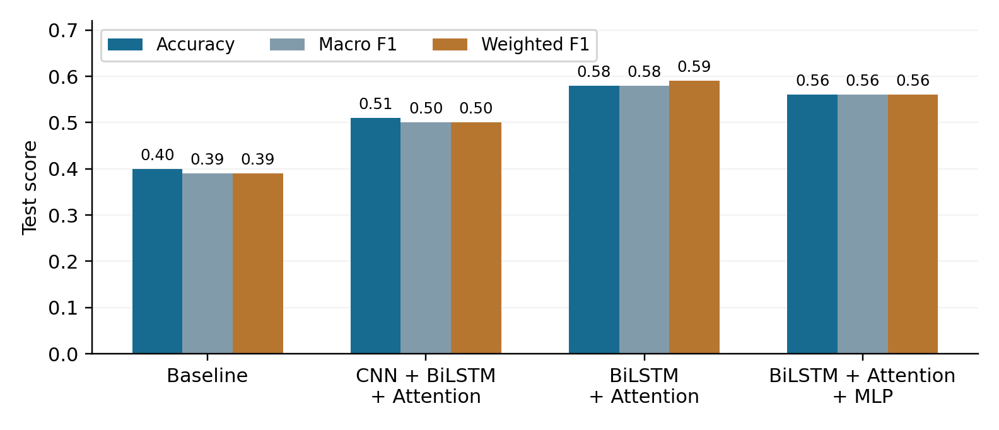
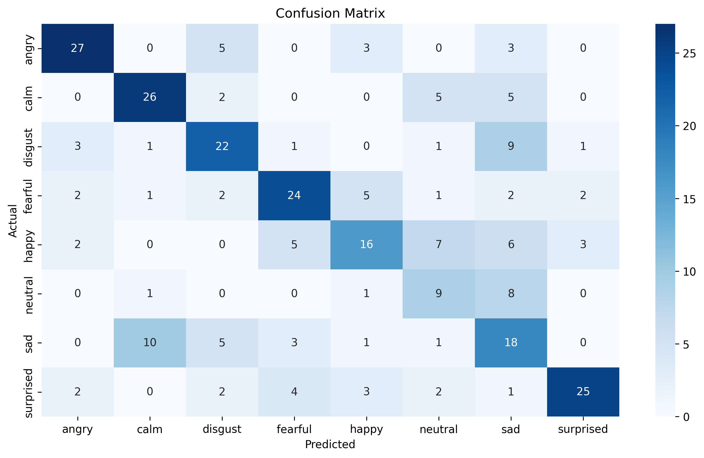
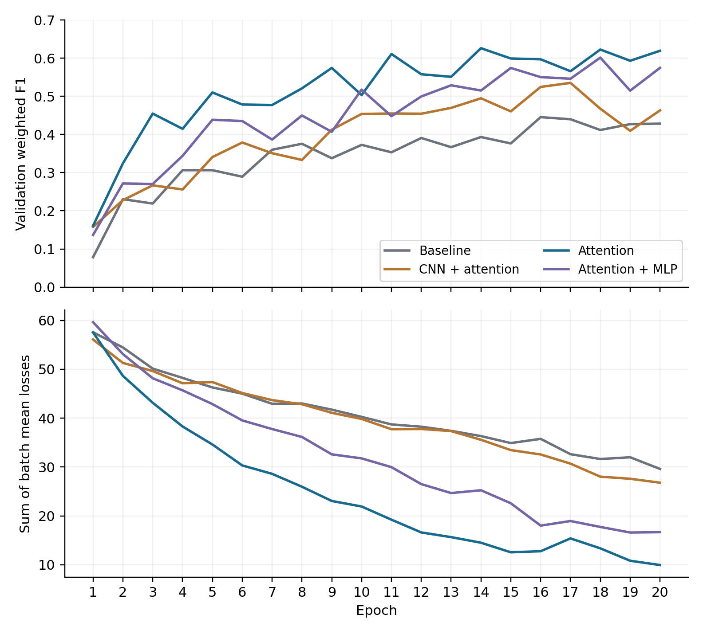
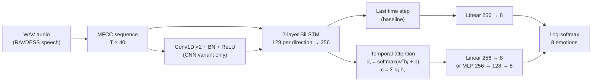

<h1 align="center">Speech Emotion Recognition with BiLSTM and Temporal Attention</h1>

<p align="center">
  <b>B.Sc. final project · School of Computer Science, Ariel University</b><br/>
  Itzhak Bista & Gal Ashkenazi · Supervised by Or Haim Anidjar & Roi Yozevitch
</p>

<p align="center">
  
  
  
  
  
  
</p>

<p align="center">
  <a href="docs/paper.pdf"><b>📄 Paper</b></a> &nbsp;·&nbsp;
  <a href="docs/poster.pdf"><b>🖼️ Poster</b></a> &nbsp;·&nbsp;
  <a href="notebooks/SER_experiments.ipynb"><b>📓 Notebook</b></a>
</p>

---

## TL;DR

We started from an open-source BiLSTM speech-emotion classifier and asked one question: **does the way recurrent outputs are summarized matter more than adding extra layers?**

We trained four architectures under **one shared protocol**: same data split, features, optimizer, epoch budget and checkpoint rule. Replacing the baseline's *last-time-step* readout with a **learned temporal-attention readout** gave:

- **Accuracy 0.40 → 0.58 (+18 pp)**, macro F1 0.39 → 0.58, weighted F1 0.39 → 0.59
- **F1 improved in all 8 emotion classes**: fearful 0.23 → 0.63, happy 0.11 → 0.47
- **Only +257 trainable parameters** (+0.045%) over the baseline
- Bigger models, a Conv1D front end and an MLP head, **did not beat** the simpler attention model

<p align="center">
  
</p>

## Results

Test set: 288 recordings, 8 classes. Each model is evaluated at the checkpoint with the best validation weighted F1.

| Model | Params | Accuracy | Macro F1 | Weighted F1 | Δ Accuracy |
|:--|--:|:--:|:--:|:--:|:--:|
| BiLSTM baseline (last time step) | 571,400 | 0.40 | 0.39 | 0.39 | — |
| CNN + BiLSTM + Attention | 581,497 | 0.51 | 0.50 | 0.50 | +11 pp |
| **BiLSTM + Temporal Attention** | **571,657** | **0.58** | **0.58** | **0.59** | **+18 pp** |
| BiLSTM + Attention + MLP head | 603,529 | 0.56 | 0.56 | 0.56 | +16 pp |

<details>
<summary><b>Per-class F1</b></summary>

| Emotion | Support | Baseline | CNN + Attn | Attention | Attn + MLP |
|:--|:--:|:--:|:--:|:--:|:--:|
| Angry | 38 | .63 | .65 | **.73** | .62 |
| Calm | 38 | .57 | .62 | **.68** | .62 |
| Disgust | 38 | .46 | .54 | **.58** | .54 |
| Fearful | 39 | .23 | .49 | **.63** | .62 |
| Happy | 39 | .11 | .44 | .47 | **.51** |
| Neutral | 19 | .37 | **.49** | .40 | **.49** |
| Sad | 38 | .21 | **.41** | .40 | .34 |
| Surprised | 39 | .52 | .39 | .71 | **.73** |

<sub>Bold marks the best score in each row. Attention beats the baseline in every class. The MLP head trades some classes against others instead of winning overall.</sub>

</details>

<table>
  <tr>
    <td width="50%"></td>
    <td width="50%"></td>
  </tr>
  <tr>
    <td align="center"><sub>Confusion matrix, BiLSTM + Attention (167/288 correct)</sub></td>
    <td align="center"><sub>Validation weighted F1 and training loss over 20 epochs</sub></td>
  </tr>
</table>

**What the errors tell us:** most remaining confusion runs through the *sad* class. 8 of 19 *neutral* and 9 of 38 *disgust* clips are predicted as *sad*, and 10 of 38 *sad* clips are predicted as *calm*. The best validation epochs were 14 to 18, not 20, so selecting checkpoints on validation F1 instead of keeping the last epoch made a real difference.

## Architectures



| Variant | Readout | Head | What it tests |
|:--|:--|:--|:--|
| Baseline | `lstm_out[:, -1, :]` | Linear | Reference model from the original repository |
| **Attention** | Learned weighted sum over all time steps | Dropout + Linear | Does learned temporal pooling help? |
| CNN + Attention | Attention, after two Conv1D layers (k=3) | Dropout + Linear | Does local filtering of MFCC frames help? |
| Attention + MLP | Attention | 256 → 128 → 8 MLP | Does a non-linear decision head help? |

The attention scorer is a single `Linear(256, 1)` followed by a softmax over time. That is 257 parameters, so the gain does not come from extra capacity.

## Experimental protocol

| Setting | Value |
|:--|:--|
| Dataset | RAVDESS audio-only speech: 1,440 WAV files, 24 professional actors, 8 emotions |
| Features | 40 MFCC coefficients per frame, with the time axis kept |
| Split | Stratified, recording-level: 921 train / 231 validation / 288 test (`random_state=42`) |
| Backbone | 2-layer bidirectional LSTM, hidden size 128 per direction, dropout 0.3 |
| Optimization | Adam (lr = 0.001), NLLLoss, batch size 32, 20 epochs, trained from scratch |
| Checkpointing | Best **validation weighted F1** (tie-break: validation accuracy) |
| Hardware | NVIDIA Tesla T4 (Google Colab) |

**Reproducibility:** the baseline repository is pinned to commit `1de5c0c`. Python, NumPy and PyTorch are seeded with 42, and the DataLoader gets its own seeded generator. Deterministic algorithms are on, cuDNN benchmarking is off, and `CUBLAS_WORKSPACE_CONFIG=:16:8`. File paths are sorted before splitting. Recorded environment: PyTorch 2.11 + CUDA 12.8, NumPy 2.1.3, librosa 0.11.0, scikit-learn 1.6.1.

## Repository structure

```
.
├── notebooks/
│   └── SER_experiments.ipynb       # end-to-end Colab workflow: data → training → evaluation
├── experiments/
│   ├── baseline/                   # model.py, best checkpoint, classification report
│   ├── cnn_attention/
│   ├── attention/                  # best model, including its confusion matrix
│   └── attention_mlp/
├── results/
│   ├── model_comparison_results.csv
│   └── figures/
├── docs/
│   ├── paper.pdf
│   └── poster.pdf
└── requirements.txt
```

## Running it

1. Open `notebooks/SER_experiments.ipynb` in Google Colab and pick a **GPU runtime**.
2. Run all cells. The notebook downloads the RAVDESS speech archive, clones the pinned baseline repository, trains all four architectures, and writes reports, checkpoints and `model_comparison_results.csv`.
3. The highest-ranked experiment is copied to `final_best_model/`.

## Limitations and future work

We are deliberately careful about what these results do and do not show.

- **Not speaker-independent.** The split is stratified by emotion, not grouped by actor. The next step is an actor-grouped split with a held-out test set that is never used for model selection.
- **One seed, one dataset, small test set** (288 clips, only 19 *neutral*), and no confidence intervals or significance tests yet.
- **Not a full ablation.** Attention was added together with classifier-input dropout. A mean or max pooling control and a proper final-hidden-state readout would isolate the effect.
- Planned: repeated seeds, cross-corpus evaluation, masking-aware attention, data augmentation, extra prosodic features, and transformer-based encoders.

## Citation

```bibtex
@misc{bista2026ser,
  title  = {Architectural Improvements for Speech Emotion Recognition Using BiLSTM and Temporal Attention},
  author = {Bista, Itzhak and Ashkenazi, Gal},
  year   = {2026},
  note   = {B.Sc. final project, School of Computer Science, Ariel University}
}
```

## References

1. Meghashyam-adimallam, *speech-emotion-recognition* (baseline repository), commit `1de5c0c`.
2. Livingstone & Russo (2018). *The Ryerson Audio-Visual Database of Emotional Speech and Song (RAVDESS).* PLOS ONE 13(5). [doi:10.1371/journal.pone.0196391](https://doi.org/10.1371/journal.pone.0196391)
3. Hochreiter & Schmidhuber (1997). *Long Short-Term Memory.* Neural Computation 9(8).
4. Mirsamadi, Barsoum & Zhang (2017). *Automatic speech emotion recognition using recurrent neural networks with local attention.* ICASSP. [doi:10.1109/ICASSP.2017.7952552](https://doi.org/10.1109/ICASSP.2017.7952552)
5. Kingma & Ba (2014). *Adam: A Method for Stochastic Optimization.* [arXiv:1412.6980](https://arxiv.org/abs/1412.6980)
